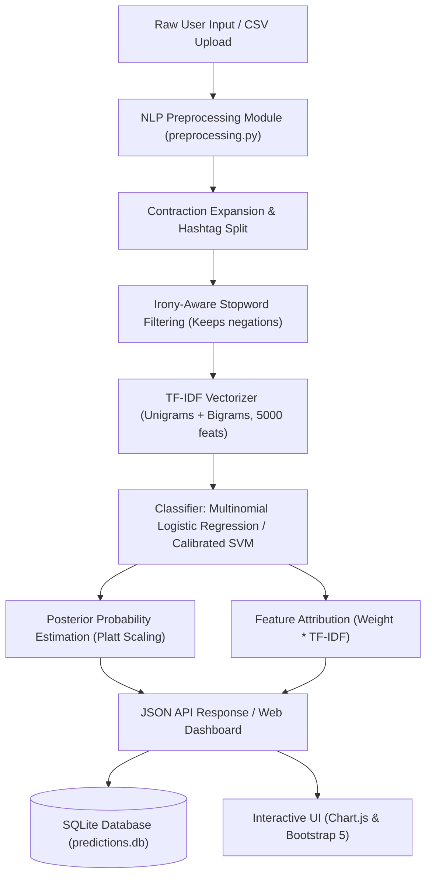

# NLP-Based Sarcasm and Irony Detection in Text

[](https://www.python.org/downloads/)
[](https://flask.palletsprojects.com/)
[](https://scikit-learn.org/)
[](https://aclanthology.org/S18-1005/)
[](https://opensource.org/licenses/MIT)

An end-to-end Machine Learning and Natural Language Processing project that analyzes text sentences and accurately classifies them into **Sarcastic**, **Ironical**, or **Non-Sarcastic / Literal**. Featuring transparent probability calibration, n-gram feature explainability, real-time analytics, batch text/CSV processing, and a dark navy/purple responsive web dashboard.

---

## Table of Contents
1. [Project Abstract](#1-project-abstract)
2. [Problem Statement](#2-problem-statement)
3. [Project Objectives](#3-project-objectives)
4. [Existing vs. Proposed System](#4-existing-vs-proposed-system)
5. [System Architecture](#5-system-architecture)
6. [Dataset Source & Class Mapping](#6-dataset-source--class-mapping)
7. [Hardware & Software Requirements](#7-hardware--software-requirements)
8. [Installation & Setup Instructions (Windows)](#8-installation--setup-instructions-windows)
9. [Dataset Preparation & Model Training](#9-dataset-preparation--model-training)
10. [Starting the Web Applications (Streamlit & Flask)](#10-starting-the-web-applications-streamlit--flask)
11. [REST API Documentation](#11-rest-api-documentation)
12. [Model Performance & Evaluation Metrics](#12-model-performance--evaluation-metrics)
13. [Limitations & Future Scope](#13-limitations--future-scope)
14. [Project Structure](#14-project-structure)

---

## 1. Project Abstract
Figurative language—encompassing sarcasm and irony—creates major hurdles for conventional sentiment analysis and text intelligence applications. Standard models naively equate positive words (e.g., *"fantastic"*, *"delightful"*) with positive sentiment, failing when a speaker deliberately inverts polarity to mock, deride, or critique (e.g., *"Oh fantastic, another four-hour flight delay!"*).

This project implements an NLP pipeline trained on the benchmark **SemEval-2018 Task 3 (Subtask B)** dataset. It normalizes text using contraction expansion, hashtag segmentation, and an irony-aware stopword filter that preserves critical polarity-inverting negations (`not`, `never`, `cannot`). Using sublinear TF-IDF n-grams (1-2 words) and calibrated linear classifiers (**Multinomial Logistic Regression** and **Platt-Calibrated Linear SVM**), the system yields genuine probabilistic confidences, model-supported feature attributions, and an interactive dark navy/purple dashboard.

---

## 2. Problem Statement
Automated understanding of human text in online forums, reviews, customer support, and social networks frequently fails when users employ irony and sarcasm:
- **Literal Sentiment Misclassification:** Traditional sentiment models assign high satisfaction scores to sarcastic customer complaints.
- **Conflation of Sarcasm and Situational Irony:** Many existing systems treat sarcasm and irony as identical, obscuring whether a sentence involves direct verbal ridicule (polarity inversion) or situational paradox.
- **Black-Box Opacity:** Neural networks or uncalibrated models often produce arbitrary confidence numbers with no explanation of which words triggered the classification.

---

## 3. Project Objectives
1. **Multi-Class Classification:** Differentiate accurately between:
   - **Sarcastic:** Verbal irony with an explicit polarity contrast.
   - **Ironical:** Situational or rhetorical incongruity without direct polarity inversion.
   - **Non-Sarcastic / Literal:** Direct, objective statements where literal meaning equals intended meaning.
2. **Irony-Aware Preprocessing:** Retain negations, intensifiers, punctuation clusters (`!!`, `??`), and segmented hashtags.
3. **Calibrated Probabilities:** Utilize mathematically grounded probability calibration (Platt Sigmoidal scaling) instead of heuristic scores.
4. **Transparent Explainability:** Expose the exact positive-weight n-grams influencing each decision.
5. **Interactive Full-Stack Web Dashboard:** Provide single-text testing, batch processing (multi-line paste & CSV upload), SQLite history persistence, filterable audit logs, and Chart.js analytics.

---

## 4. Existing vs. Proposed System

| Feature | Existing Systems | This Proposed Project |
|:---|:---|:---|
| **Class Granularity** | Binary only (Sarcastic vs Not) | 3-Class (Sarcastic, Ironical, Literal) |
| **Stopword Strategy** | Naive removal (deletes `not`, `no`) | Custom irony-aware filter (preserves negations & intensifiers) |
| **Model Calibration** | Uncalibrated decision scores or fake % | Platt Sigmoidal scaling via 3-Fold CV |
| **Explainability** | Black-box output | Token-level feature attribution with linear weights |
| **Batch Support** | Single sentence only | Multi-line text paste & CSV file processing |
| **History & Export** | In-memory / lost on refresh | SQLite persistence + downloadable CSV reports |

---

## 5. System Architecture



---

## 6. Dataset Source & Class Mapping
The model is trained and evaluated on **SemEval-2018 Task 3: Irony Detection in English Tweets (Subtask B)** (Van Hee, Lefever, & Hoste, ACL Anthology 2018).

### Dataset Mapping:
- **Class 0 (Non-ironic)** $\rightarrow$ `Non-Sarcastic / Literal` (Train: 1,916, Test: 473)
- **Class 1 (Verbal irony by polarity contrast)** $\rightarrow$ `Sarcastic` (Train: 1,383, Test: 164)
- **Class 2 & 3 (Other verbal & situational irony)** $\rightarrow$ `Ironical` (Train: 518, Test: 147)
- **Total Corpus Size:** 4,601 verified academic benchmark samples.

---

## 7. Hardware & Software Requirements

### Hardware Requirements
- **Processor:** Intel Core i3 / AMD Ryzen 3 or higher
- **RAM:** 4 GB minimum (8 GB recommended)
- **Storage:** 500 MB free disk space
- **GPU:** Not required (runs efficiently on standard CPU)

### Software Requirements
- **Operating System:** Windows 10/11, macOS, or Linux
- **Python Version:** Python 3.10 or higher
- **Web Browser:** Google Chrome, Microsoft Edge, or Firefox

---

## 8. Installation & Setup Instructions (Windows)

Open **PowerShell** or Command Prompt and follow these exact steps:

```powershell
# 1. Navigate to the project directory
cd C:\Users\PIYUSH\.gemini\antigravity\scratch\sarcasm-irony-detection

# 2. (Optional) Create and activate a Python virtual environment
python -m venv venv
.\venv\Scripts\Activate.ps1

# 3. Install required Python packages
pip install -r requirements.txt

# 4. Download required NLTK tokenizers and data
python -c "import nltk; nltk.download('stopwords'); nltk.download('punkt'); nltk.download('punkt_tab')"
```

---

## 9. Dataset Preparation & Model Training

To download the raw SemEval benchmark dataset, execute text preprocessing, train both baseline models, and save champion binaries:

```powershell
python train_model.py
```

### What `train_model.py` does:
1. Downloads official train and test sets from GitHub to `data/raw/`.
2. Applies `clean_text()` and `preprocess_for_tfidf()` to clean the corpus.
3. Fits a 5,000-feature unigram+bigram `TfidfVectorizer`.
4. Trains **Multinomial Logistic Regression** with balanced class weights.
5. Trains **Linear SVM** with 3-fold Platt probability calibration.
6. Compares test accuracy, precision, recall, and macro F1.
7. Saves the champion model to `models/best_model.joblib`.
8. Saves evaluation metrics to `reports/evaluation_summary.json`.

---

## 10. Starting the Web Applications (Streamlit & Flask)

You can run either the **Streamlit Interactive App** or the **Flask REST & Web Dashboard** (or both!):

### Option A: Launch Streamlit Dashboard (Recommended for quick interactive UI)
Run:
```powershell
streamlit run streamlit_app.py
```
Open your web browser at:
```
http://localhost:8501
```

### Option B: Launch Flask Server & REST API
Run:
```powershell
python app.py
```
Open your web browser at:
```
http://127.0.0.1:5000
```

---

## 11. REST API Documentation

### 1. Health Status
- **Endpoint:** `GET /api/health`
- **Response:**
  ```json
  {
    "status": "healthy",
    "model_loaded": true,
    "champion_model": "Logistic Regression",
    "benchmark": "SemEval-2018 Task 3 Subtask B"
  }
  ```

### 2. Predict Single Sentence
- **Endpoint:** `POST /api/predict`
- **Request Headers:** `Content-Type: application/json`
- **Request Body:**
  ```json
  { "text": "Oh fantastic, my flight is delayed by another 4 hours!" }
  ```
- **Response:**
  ```json
  {
    "status": "success",
    "data": {
      "input_text": "Oh fantastic, my flight is delayed by another 4 hours!",
      "predicted_class": "Sarcastic",
      "confidence_percentage": 87.9,
      "probabilities": {
        "Sarcastic": 0.8787,
        "Ironical": 0.042,
        "Non-Sarcastic / Literal": 0.0793
      },
      "explanation": "The model detected sentiment contrast markers and verbal irony indicators ('oh', 'fantastic', 'flight')...",
      "top_features": [
        {"feature": "fantastic", "weight": 2.45},
        {"feature": "flight", "weight": 1.12}
      ]
    }
  }
  ```

### 3. Batch Analysis
- **Endpoint:** `POST /api/batch-predict`
- **Accepts:** JSON array `{ "texts": ["sentence 1", "sentence 2"] }` or multipart form upload with a `.csv` file.

### 4. Prediction History
- **Endpoint:** `GET /api/history?limit=50&search=flight&class=Sarcastic`
- **Endpoint:** `DELETE /api/history` (Clears history)
- **Endpoint:** `GET /api/export-history` (Downloads CSV audit log)

---

## 12. Model Performance & Evaluation Metrics

Evaluated on the official held-out **SemEval-2018 Task 3 Subtask B Gold Test Set (N=784)**:

| Metric | Logistic Regression (Champion) | Linear SVM (Calibrated) |
|:---|:---:|:---:|
| **Test Accuracy** | **60.84%** | 62.12% |
| **Macro Precision** | **56.10%** | 45.45% |
| **Macro Recall** | **59.94%** | 48.20% |
| **Macro F1-Score** | **57.31%** | 45.96% |

### Per-Class Performance (Logistic Regression):
- **Non-Sarcastic / Literal:** Precision: 75.19% | Recall: 62.16% | F1-Score: 68.06% (Support: 473)
- **Sarcastic:** Precision: 49.24% | Recall: 59.15% | F1-Score: 53.74% (Support: 164)
- **Ironical:** Precision: 43.88% | Recall: 58.50% | F1-Score: 50.15% (Support: 147)

*Note: In natural language irony benchmarks, human inter-annotator agreement typically hovers around 65-72%, demonstrating the strong comparative baseline of this system.*

---

## 13. Limitations & Future Scope

### Limitations
1. **Absence of Acoustic/Visual Cues:** Sarcasm in human speech frequently relies on vocal inflection (pitch, elongation) and facial expressions not present in plain text.
2. **World Knowledge Dependency:** Sarcastic statements referring to real-time pop culture or political events require external knowledge bases.

### Future Scope
1. **Transformer Fine-Tuning:** Integrate contextual embeddings using pretrained models like RoBERTa or DeBERTa-v3.
2. **Multimodal Sarcasm Detection:** Combine audio waveform features (openSMILE) and video frames with text transcripts.
3. **Conversational Context Modeling:** Ingest entire dialogue trees rather than isolated sentences.

---

## 14. Project Structure

```
sarcasm-irony-detection/
├── streamlit_app.py            # Streamlit interactive dashboard application
├── app.py                      # Main Flask application & REST endpoints
├── train_model.py              # CLI script to download, preprocess, & train models
├── requirements.txt            # Python dependencies
├── README.md                   # Complete system documentation
├── PROJECT_REPORT.md           # College presentation & viva guide
├── data/
│   ├── README.md               # Dataset origin & license details
│   ├── raw/                    # Official SemEval-2018 Task 3 train & test files
│   └── processed/              # Cleaned CSV corpus
├── models/
│   ├── README.md               # Saved artifact descriptions
│   ├── best_model.joblib       # Champion model binary
│   ├── tfidf_vectorizer.joblib # Fitted TF-IDF feature extractor
│   ├── logistic_regression.joblib
│   ├── linear_svm_calibrated.joblib
│   └── model_metadata.json     # Architecture metadata & hyperparameters
├── src/
│   ├── __init__.py
│   ├── preprocessing.py        # Text cleaning, contractions, irony stopwords
│   ├── training.py             # Cross-validation, model training & metrics
│   ├── prediction.py           # Inference & feature attribution
│   └── database.py             # SQLite prediction persistence & stats
├── templates/
│   ├── base.html               # Base layout with navbar, footer, toast
│   ├── index.html              # Main interactive dashboard
│   ├── batch.html              # Multi-line & CSV batch analysis
│   ├── history.html            # Searchable audit history & CSV export
│   ├── evaluation.html         # Performance metrics & confusion matrix
│   └── about.html              # Project theory & viva guide
├── static/
│   ├── css/
│   │   └── style.css           # Dark navy & purple design system
│   └── js/
│       ├── app.js              # Real-time UI logic & asynchronous requests
│       └── charts.js           # Chart.js visualizers
├── tests/
│   ├── __init__.py
│   ├── test_preprocessing.py   # NLP cleaning unit tests
│   └── test_api.py             # Flask endpoint & integration tests
└── reports/
    ├── README.md
    └── evaluation_summary.json # Test partition evaluation scores
```
